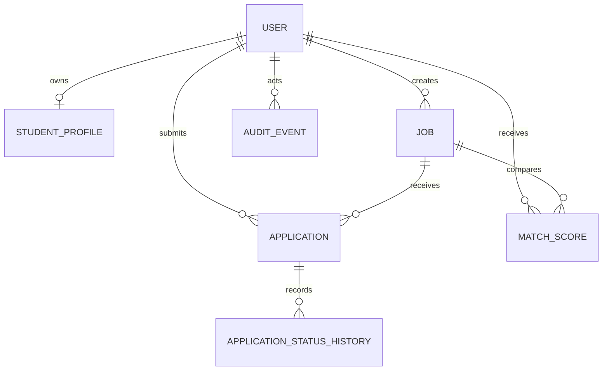

# Database Schema and Data Dictionary

## 1. Storage strategy

Current persistence is MongoDB through Mongoose. Resume binaries should be stored in private object storage; MongoDB stores metadata and opaque references. The schema below distinguishes fields verified in current Mongoose models from future design extensions.

## 2. Current collections

### users — current model
| Field | Type | Rules |
|---|---|---|
| _id | ObjectId | MongoDB primary key |
| name | String | required |
| email | String | required, unique; normalize before save (recommended) |
| password | String | required; bcrypt hash via pre-save hook |
| role | String | enum: student/admin/company; default student |
| isActive | Boolean | default true |
| createdAt/updatedAt | Date | Mongoose timestamps |

**Security note:** current model permits company role, but company APIs are future scope. Public registration must not let clients select admin/company roles.

### studentprofiles — current model
| Field | Type | Rules |
|---|---|---|
| userId | ObjectId ref User | required, unique |
| education.college | String | optional in current schema |
| education.degree | String | optional |
| education.branch | String | optional |
| education.graduationYear | Number | optional |
| education.cgpa | Number | optional; range validation should be added |
| skills | String[] | default [] |
| experience | String | default empty |
| projects | String | default empty |
| resumeUrl | String | default empty; should become private storage key/reference |
| createdAt/updatedAt | Date | timestamps |

### jobs — current model
| Field | Type | Rules |
|---|---|---|
| title | String | required |
| description | String | required |
| requiredSkills | String[] | default [] |
| minExperience | Number | default 0 |
| eligibilityCriteria.cgpa | Number | optional |
| eligibilityCriteria.branch | String[] | optional |
| eligibilityCriteria.graduationYear | Number | optional |
| location | String | default empty |
| status | String | enum open/closed; default open |
| createdBy | ObjectId ref User | required |
| createdAt/updatedAt | Date | timestamps |

### applications — current model
| Field | Type | Rules |
|---|---|---|
| studentId | ObjectId ref User | required |
| jobId | ObjectId ref Job | required |
| status | String | enum applied/shortlisted/selected/rejected; default applied |
| createdAt/updatedAt | Date | timestamps |

Current model defines a unique compound index on `studentId + jobId`.

## 3. Planned collections / extensions

### applicationstatushistory (planned)
- applicationId, fromStatus, toStatus, actorUserId, reason, createdAt.
- Append-only; status transition and history write should be atomic.

### eligibilityevaluations (planned)
- studentId, jobId, outcome (eligible/ineligible/needs_review), reasons[], criteriaVersion, profileVersion, evaluatedAt, evaluatedBy (system/admin).
- Retain the rule version and inputs needed for audit.

### resumemetadata (planned)
- studentId, storageKey, originalName (sanitized), contentType, sizeBytes, checksum, uploadedAt, parseStatus, parserVersion, deletedAt.
- No public URL or raw resume text in ordinary API responses.

### matchscores (planned; master notes)
- studentId, jobId, score, matchedSkills[], missingSkills[], aiVersion, createdAt.
- Recommended: algorithmVersion, inputSnapshotHash, explanation, confidence/limitations, stale flag, evaluatedAt.
- Advisory only; not an application decision.

### auditevents (planned)
- actorId, action, resourceType, resourceId, before/after summary (redacted), requestId, timestamp, source.
- Append-only permissions and retention policy.

### notifications (planned)
- recipientId, type, template/version, payload (minimal), deliveryState, attempts, nextAttemptAt, sentAt, createdAt.

## 4. Relationships

## 5. Index plan

- users: unique normalized email.
- studentprofiles: unique userId (already declared).
- jobs: status + createdAt; deadline/status when deadline field is added; text/search indexes only after query design.
- applications: unique studentId + jobId (already declared); jobId + status + createdAt; studentId + createdAt.
- eligibilityevaluations: studentId + jobId + criteriaVersion.
- matchscores: studentId + jobId + algorithmVersion.
- auditevents: resourceId + timestamp; actorId + timestamp.
- notifications: recipientId + deliveryState + nextAttemptAt.

Validate indexes against production query patterns and index build cost.

## 6. Data integrity and migration policy

- Validate ObjectIds and references before writes.
- Normalize email consistently.
- Keep role assignment server-controlled.
- Enforce unique application pair in MongoDB, not only controller code.
- Define enum/status transitions centrally.
- Use optimistic concurrency or atomic conditional updates for state transitions.
- Define deletion, archival, retention, and legal hold rules.
- For schema changes, document backfill, defaults, compatibility, index rollout, rollback, and test fixtures.

## 7. Privacy classification

- **Public:** published job information.
- **Internal:** operational configuration and aggregate metrics.
- **Confidential:** student profile, application, eligibility and selection data.
- **Highly sensitive:** password hashes, tokens/secrets, resume binaries and extracted personal content.

Do not include sensitive fields in logs, analytics, or unrestricted exports.
