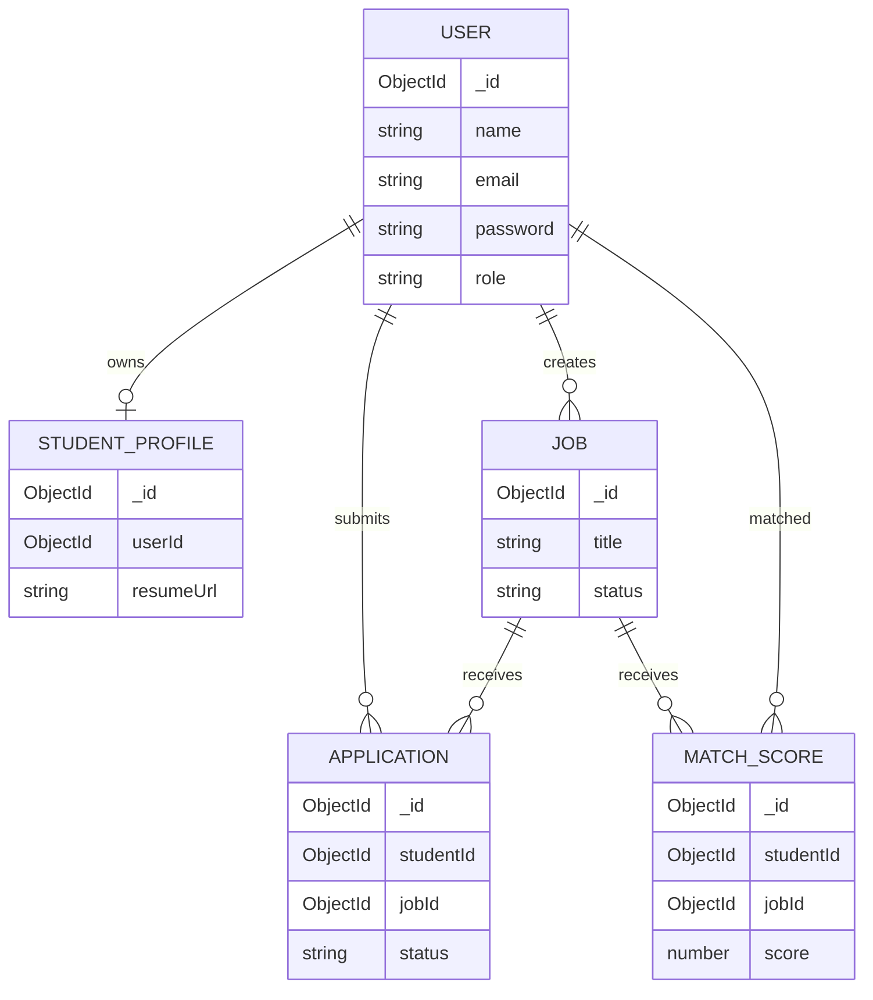

# Database Schema

## 1. Database technology

The current backend uses MongoDB through Mongoose. The project master notes describe MongoDB Atlas as the target hosting option. This document distinguishes model concepts already recorded in the project from proposed extensions; verify each schema file before relying on every field name.

## 2. Current domain collections

The project contains Mongoose models for user, student profile, job, and application data.

### users

Purpose: authentication identity and role.

Master-notes fields:
- `name`
- `email` (unique)
- `password` (hashed)
- `role` (student | admin | company in the notes)
- `isActive`
- `createdAt`

Security: never return password hashes; normalize email; enforce a unique index; validate role assignment on the server. Public registration should not allow a client to grant itself admin privileges.

### studentProfiles

Purpose: academic and resume-related student information.

Master-notes fields:
- `userId` (reference to users)
- `resumeUrl`
- `extractedSkills[]`
- `education`
- `experience`
- `projects`
- `createdAt`
- `updatedAt`

Recommended constraints: one profile per student account unless product rules explicitly require versioning; index `userId`; protect resume references.

### jobs

Purpose: placement opportunities and eligibility requirements.

Master-notes fields:
- `title`
- `description`
- `requiredSkills[]`
- `minExperience`
- `eligibilityCriteria`
- `location`
- `status` (open | closed)
- `createdBy`
- `createdAt`

Recommended indexes: `status`, deadline if present, and fields used for search/filtering. Store eligibility rules in a validated structured shape rather than relying on free text alone.

### applications

Purpose: student-to-job application and status tracking.

Master-notes fields:
- `studentId` (reference to users)
- `jobId` (reference to jobs)
- `status` (applied | shortlisted | selected | rejected)
- `appliedAt`

Recommended constraint: compound unique index on `studentId + jobId` to prevent duplicates. Define allowed transitions and record status history/actor in a future schema enhancement.

## 3. Planned matching data

### matchScores (planned)

- `studentId`
- `jobId`
- `score`
- `matchedSkills[]`
- `missingSkills[]`
- `aiVersion`
- `createdAt`

Recommended additions: algorithm/config version, input snapshot hash, scoring explanation, evaluation metadata, and status such as current/stale. Do not treat this as a final hiring decision.

## 4. Relationships

## 5. Data integrity

- Validate ObjectId references before querying dependent records.
- Enforce unique email and unique student/job application pair at the database level where possible.
- Add indexes based on measured query patterns.
- Define deletion/retention rules for accounts, resumes, applications, and audit records.
- Avoid cascading destructive deletion without an approved retention policy.
- Store timestamps consistently and return ISO-8601 values through the API.
- Keep private fields out of serialization by default.

## 6. Migration and schema change policy

MongoDB schema evolution still requires deliberate migration/backfill planning. For every schema change, document compatibility with existing records, defaults, indexes, rollback strategy, and test fixtures. Update this document alongside the model files.

> This document is a design summary based on the repository's master notes and model inventory, not a substitute for reading the actual Mongoose schema definitions. Confirm field types, required flags, enums, references, and indexes directly in `server/src/models/` before implementation.
