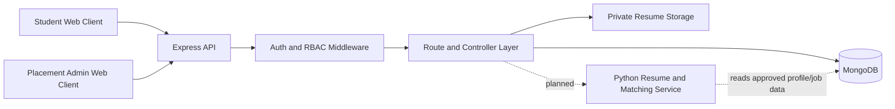

# System Architecture

## 1. Current architecture status

The repository currently contains a Node.js/Express API organized into route, controller, middleware, model, and configuration directories. MongoDB is accessed through Mongoose. The React/Tailwind frontend and Python AI service are described in project notes as planned components; they are not confirmed as present in the repository.

## 2. Target logical architecture

## 3. Current backend layers

- **Entrypoint:** `server/server.js` loads environment configuration, connects to MongoDB, and starts the HTTP server.
- **Application composition:** `server/src/app.js` configures Express, CORS, JSON parsing, upload static path, and route mounts.
- **Routes:** map HTTP methods and paths to middleware/controllers.
- **Controllers:** implement request-level business operations.
- **Models:** define Mongoose document structures.
- **Middleware:** authentication/authorization and file upload handling.
- **Configuration:** database connection logic.

## 4. Main domain modules

| Module | Responsibility |
|---|---|
| Auth | User registration, login, token identity |
| Student | Student profile and resume metadata |
| Jobs | Job posting discovery and lifecycle |
| Applications | Applications and their status lifecycle |
| Admin | Placement administration; expand behind authorization |
| AI matching (planned) | Resume extraction, skills normalization, explainable matching |

## 5. Request flow

1. Client sends an HTTPS request to the API.
2. Express applies global parsing/CORS middleware.
3. Router selects the endpoint.
4. Authentication middleware verifies the token where required.
5. Authorization checks role and resource ownership.
6. Controller validates input and invokes the domain/model layer.
7. Mongoose reads or writes MongoDB.
8. API returns a consistent JSON response and appropriate HTTP status.

## 6. Data ownership and trust boundaries

- Client input is untrusted, including user IDs, role values, resume metadata, and job IDs.
- JWT claims must be verified using a secret held by the server.
- A role claim grants only the permissions explicitly assigned to that role.
- Student profile and resume access must be checked against the authenticated identity.
- AI service access should use an authenticated internal boundary and receive only the minimum required data.
- Resume storage should be private; a public static mount is not an acceptable final access policy for confidential resumes.

## 7. Deployment topology (target)

- Static frontend hosted on a static hosting/CDN platform.
- Express API hosted as a separate service.
- Managed MongoDB with network restrictions, backups, and least-privilege credentials.
- Private object/file storage for resumes.
- AI service deployed separately only after its API, authentication, privacy, and evaluation approach are agreed.
- Centralized error monitoring and structured application logs.

No cloud provider, production hostname, or deployment architecture is mandated by the current repository.

## 8. Reliability and scaling

- Use pagination for student/job/application collections.
- Add appropriate indexes after examining query patterns.
- Avoid loading full resume binaries into ordinary API list responses.
- Configure request size limits, upload limits, timeouts, and rate limiting.
- Use background jobs for expensive document parsing/matching once needed.
- Add health/readiness checks and graceful shutdown.
- Back up MongoDB and verify restoration periodically.

## 9. Architecture decisions to record

Before implementing a new service, record its owner, data contract, auth method, retry/timeout policy, failure behavior, observability, and deployment dependencies. Do not split the current small API into microservices without a demonstrated scaling or ownership need.
