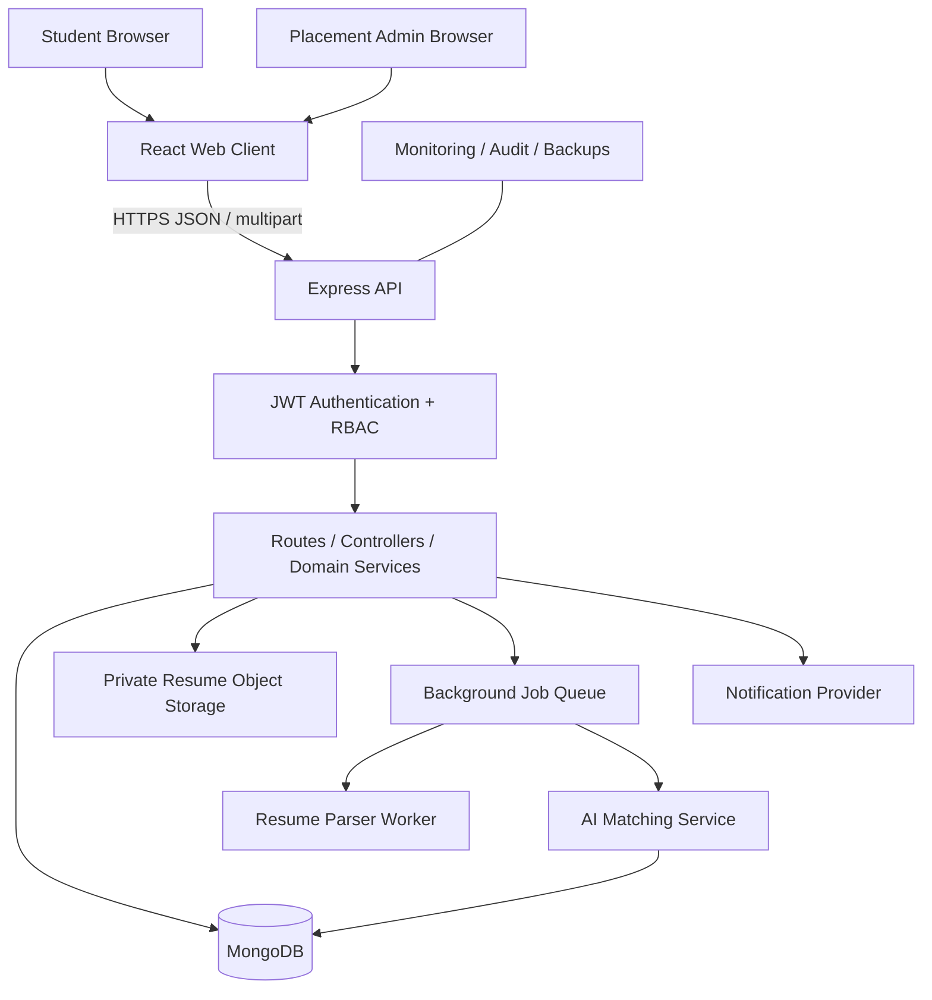

# System Architecture and Technical Design

## 1. Architecture status

**Current code:** Express 5 application in `server/`, CommonJS modules, Mongoose models, MongoDB connection, route/controller/middleware separation.  
**Planned:** React + Tailwind web client, structured eligibility service, private object storage, notification worker, Python AI service. These are not present in the current repository baseline.

## 2. Target logical architecture

## 3. Backend request flow

1. Request reaches HTTPS reverse proxy/API.
2. Express applies security headers, CORS allowlist, request limits, and parsers.
3. Router validates path/query/body/file.
4. Authentication middleware verifies token and active account.
5. Authorization policy checks role, ownership, and resource scope.
6. Controller maps HTTP request/response; domain service applies business rules.
7. Mongoose reads/writes MongoDB; file operations use private storage.
8. Audit event/outbox is written for important state changes.
9. API returns a stable response envelope and status code.

## 4. Module boundaries

| Module | Responsibilities |
|---|---|
| Auth | Registration, login, token lifecycle, account status |
| Users | Identity and role administration |
| Students | Profile, education, skills, readiness |
| Resumes | Upload, private download, metadata, parser lifecycle |
| Jobs | Posting lifecycle, search, visibility, deadlines |
| Eligibility | Rule evaluation, explanation, versioning, overrides |
| Applications | Apply, uniqueness, status transitions/history |
| Admin | Student/job/applicant operations, reports |
| Notifications | Event delivery, retries, preferences |
| Audit | Append-only record of sensitive/admin actions |
| AI integration | Authenticated request/response contract to parser/matcher |
| Operations | Health, metrics, logging, configuration |

## 5. Trust boundaries

- Browser is untrusted; user-supplied IDs, roles, file metadata, and scores cannot grant access.
- Public registration can only create permitted default roles.
- MongoDB credentials are server-only and least-privilege.
- Resume storage is private; download goes through authorization or short-lived signed URL.
- AI service receives only the minimum required profile/job/resume text.
- AI response is untrusted input: validate schema, bounds, version, and references.
- Admin exports are a separate sensitive data boundary.

## 6. Data flow and consistency

- MongoDB stores identity, profile, jobs, applications, eligibility results, audit references, and match metadata.
- Resume binaries belong in private object storage, not public static directories or MongoDB documents by default.
- Application uniqueness must be enforced by a compound unique index on student/job.
- Status updates should be atomic and append a history/audit event.
- Parsing/matching should be asynchronous, idempotent, retryable, and associated with an input version/hash.
- A match result becomes stale when relevant profile, resume, job, or criteria changes.

## 7. Deployment topology (provider-neutral)

- Static frontend served via HTTPS/CDN.
- Express API behind TLS-terminating proxy/load balancer.
- Managed MongoDB with network restrictions, backups, encryption, and least-privilege credentials.
- Private object storage with lifecycle/retention policies.
- Queue/worker for parsing and notification jobs.
- AI service deployed separately with internal authentication and strict network access.
- Central logs/metrics/traces with alerting and redaction.

No production provider, domain, region, or capacity number is asserted until selected and load-tested.

## 8. Resilience and scaling

- Keep API stateless; externalize session/revocation state if needed.
- Add pagination and indexes for all high-cardinality lists.
- Bound request bodies, uploads, processing time, and concurrency.
- Use queue retries with backoff and dead-letter handling.
- Avoid N+1 database queries and unbounded populate operations.
- Add caching only with explicit invalidation and privacy isolation.
- Configure graceful shutdown, readiness/liveness checks, and DB timeouts.
- Define RPO/RTO and verify restore procedures.

## 9. Architecture decision records

Record major decisions for frontend framework/build, auth/token lifecycle, file storage, eligibility rule model, status state machine, notifications, AI service framework/model, deployment, and analytics. Each record includes context, alternatives, decision, consequences, security impact, and date.
