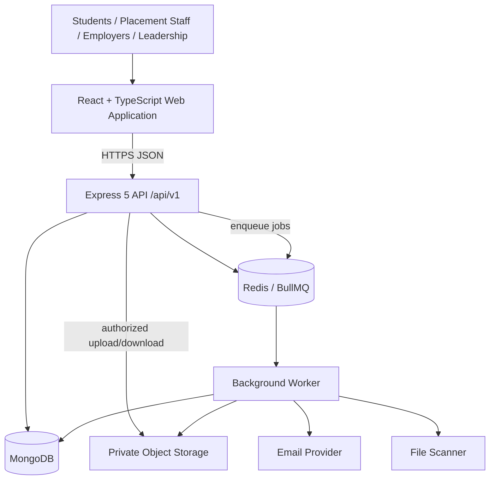

# Placement Portal — System Architecture

**Version:** 1.0  
**Status:** Proposed baseline; vendor choices remain open  
**Architecture style:** TypeScript monorepo, modular Express API and separate background worker  
**Database:** MongoDB with Mongoose  
**Cache/queue:** Redis with BullMQ (target)

## 1. Architecture goals

- Keep the web client, API and worker independently runnable and deployable.
- Centralize business rules and authorization in the API/domain layer.
- Enforce institution, company, ownership, assignment and field-level boundaries.
- Keep workflows auditable and state transitions consistent.
- Support incremental delivery as a modular monolith before considering service extraction.
- Support automated tests, observability, recovery and horizontal scaling.

## 2. High-level topology

The diagram is logical. The initial API is a modular monolith, not a set of microservices. The worker is a separately deployable process that shares domain contracts and infrastructure adapters.

## 3. Application boundaries

### Web application
Renders public pages and authenticated role workspaces. It may hide unavailable navigation for usability but is never an authorization authority. It calls the API through one centralized client and consumes safe DTOs.

### API
Owns authentication, membership resolution, RBAC/ABAC, validation, business rules, MongoDB access, file authorization, state transitions, audit events and outbox creation. No client-supplied role, tenant, owner or status is trusted.

### Worker
Processes email notifications, deadline reminders, resume scan requests, export generation, cleanup and other asynchronous work. Jobs must be idempotent, bounded, retryable and observable. Dead-letter handling and manual replay require an operator procedure.

### Infrastructure adapters
MongoDB, Redis, private object storage, email, malware scanning and optional AI are accessed through server-side adapters. Provider-specific SDKs must not leak into domain rules.

## 4. Backend modular domains

- Identity: accounts, credentials, verification, sessions and recovery.
- Institutions: tenant records, academic years, programs, departments and cohorts.
- Memberships: user-to-institution/company memberships and active context.
- Students: profile, academic data, verification and roster import.
- Files: private resume/document metadata, upload authorization and download policy.
- Companies: onboarding, verification, company teams and invitations.
- Opportunities: drafts, review, approval, publication and lifecycle.
- Eligibility: policy versions, evaluation and reason codes.
- Applications: submission, snapshots, assignments, status and history.
- Drives: recruitment rounds, stage configuration and candidate progression.
- Interviews: schedules, invitations, response and attendance.
- Offers: issue, acceptance, decline, expiry and revocation.
- Notifications: in-app records, email jobs, preferences and delivery attempts.
- Reports: scoped metrics, exports and aggregation pipelines.
- Audit: append-only security and business audit events.
- Health: liveness, readiness and dependency status.

Modules expose application services/contracts; they must not import one another's controllers or route handlers.

## 5. Request lifecycle

1. Assign/validate request ID and apply security middleware.
2. Parse and validate request size/content type.
3. Authenticate access credential.
4. Resolve active membership from server-side records.
5. Check account and membership state.
6. Check permission, resource scope, ownership, assignment and field visibility.
7. Validate allowlisted input and business state transition.
8. Execute use case and persistence transaction/conditional writes.
9. Append audit and outbox records where required.
10. Return safe response DTO; dispatch async side effects after commit.

## 6. Consistency and event delivery

For critical mutations, persist the domain change and outbox event atomically where transaction support is available. Worker delivery is at-least-once; consumers deduplicate by event ID. Use unique constraints and conditional updates to prevent duplicate application submissions and conflicting transitions. Do not assume queue delivery is exactly once.

## 7. Scalability and performance

- Keep API instances stateless.
- Use compound indexes matching institution/company/status/date filters.
- Require pagination and bounded date ranges for list/report endpoints.
- Cache only data with clear invalidation and no private cross-tenant leakage.
- Use queues for email, scanning, exports and scheduled reminders.
- Apply per-tenant and per-user concurrency/rate limits.
- Stream large exports/files; never load unbounded datasets into memory.
- Measure slow queries, queue age, API latency and error rates before scaling.

## 8. Reliability and observability

Expose liveness and readiness separately. Readiness checks MongoDB and required dependencies. Use structured logs with requestId/traceId, module, action, result and duration. Redact secrets and sensitive student content. Track queue retries/dead letters, file scan failures, authorization denials, application transition conflicts and export activity.

## 9. Security boundaries

The browser is untrusted. MongoDB is private. Resume objects are private. Platform operations do not imply student-data access. Recruiter access is company/opportunity scoped. Leadership reporting is aggregate by default. Emergency support access is time-limited and audited.

## 10. Architecture decisions to finalize

- Hosting, MongoDB and Redis providers.
- Object storage and malware scanning provider.
- Email delivery provider.
- Access/refresh token transport and cookie domain strategy.
- Exact API and web local ports.
- Institution tenancy model (shared database with tenant-scoped documents is the baseline).
- Retention schedule, SLO, RPO and RTO.
- Whether Socket.IO is needed for MVP or polling is sufficient.
